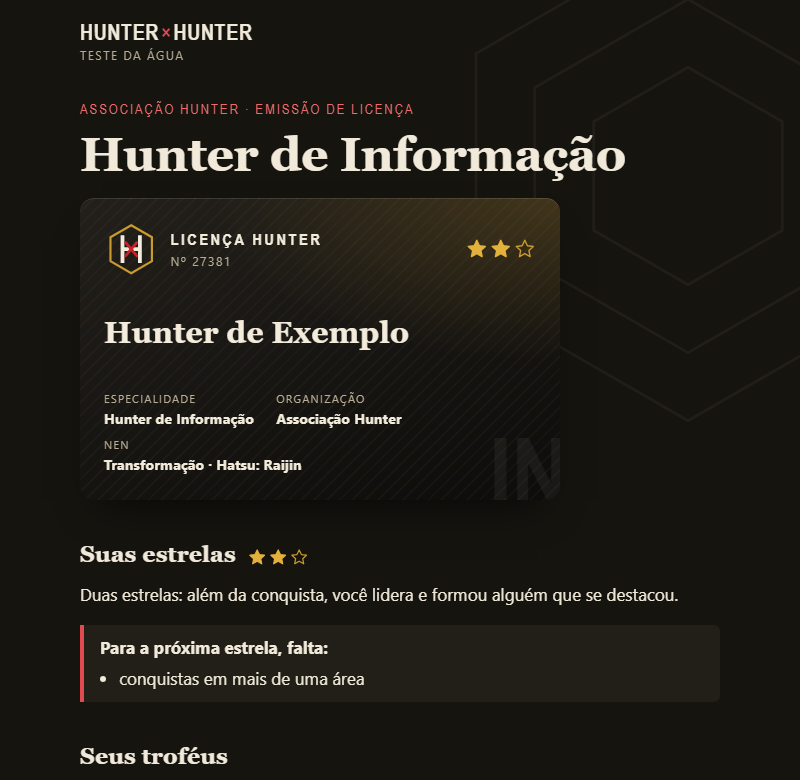
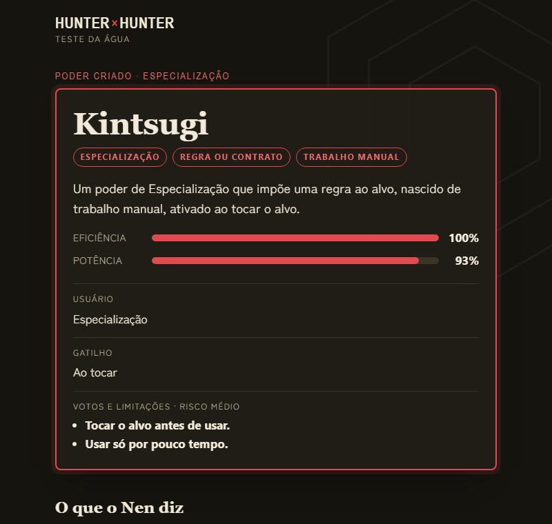

# Quiz HxH — Qual é o seu tipo de Nen?

**[▶ Jogar agora: samuelgomezdev.github.io/quiz-hxh](https://samuelgomezdev.github.io/quiz-hxh/)**

Um quiz de Hunter × Hunter que faz o papel do Teste da Água: suas respostas revelam o seu tipo de Nen, a afinidade com os outros cinco tipos e os personagens que compartilham a sua aura. Depois, você pode desenvolver o seu próprio Hatsu a partir do que viveu, montar um poder peça por peça e tirar a sua Licença Hunter com os feitos da sua vida.

| Início | Teste Trupe Fantasma | Teste Zodíaco |
| --- | --- | --- |
| [](https://samuelgomezdev.github.io/quiz-hxh/) | [](https://samuelgomezdev.github.io/quiz-hxh/#/quiz/trupe) | [](https://samuelgomezdev.github.io/quiz-hxh/#/quiz/zodiaco) |

| Licença Hunter | Crie o seu poder |
| --- | --- |
| [](https://samuelgomezdev.github.io/quiz-hxh/#/feitos) | [](https://samuelgomezdev.github.io/quiz-hxh/#/poder) |

- **Dois testes:** 13 perguntas inspiradas nos membros da Trupe Fantasma ou 12 nos signos do Zodíaco, cada um com identidade visual própria.
- **Resultado com base na obra:** o copo reage como no Teste da Água, o hexágono mostra a afinidade e a lista traz os personagens do mesmo tipo, com link para a Hunterpedia e a fonte de cada tipo.
- **Hatsu e "Crie o seu poder":** a habilidade nasce do tipo e da vivência, e o construtor avalia o poder que você montar pela teoria do Nen.
- **Licença Hunter:** os feitos da sua vida definem especialidade, estrelas (pela regra da Associação) e organização, num cartão com Hunters reais da mesma área.
- **Tudo compartilhável:** cada link guarda as respostas e recalcula o resultado ao abrir.

Projeto de estudo de Análise e Desenvolvimento de Sistemas: requisitos, ETL a partir da API da [Hunterpedia](https://hunterxhunter.fandom.com/wiki/Hunterpedia), modelagem de dados, motor de pontuação testado, interface em React e publicação automática com GitHub Actions.

## Estrutura

```
etl/
  api.mjs          cliente da API MediaWiki: limite de 1 req/s, User-Agent, cache em .cache/
  extrair.mjs      E: lista as páginas com a infobox Hunterpedia:Character e baixa o wikitext
  wikitext.mjs     funções puras para ler infobox, referências e categorias
  tipo-nen.mjs     regra de negócio: interpreta o campo "type"
  hunter.mjs       regra de negócio: lê "occupation" → Hunter, especialidade e estrelas
  imagens.mjs      busca o retrato principal de cada página (PageImages)
  transformar.mjs  T: monta Personagem e Fonte; corrige a fonte do tipo pelas categorias
  index.mjs        pipeline completo, validação e gravação (L)
conteudo/
  perguntas.mjs    autoral: 25 perguntas (Trupe e Zodíaco), só texto e tipo
  hatsu.mjs        autoral: vivências × tipos (72 Hatsus), motivações, alcances, votos e referências da obra
  poder.mjs        autoral: formas, gatilhos e comentários do "Crie o seu poder"
  feitos.mjs       autoral: 21 feitos, 7 especialidades, 6 organizações e as perguntas de organização
motor/
  pontuacao.mjs    algoritmo de pontuação e afinidade pelo hexágono
  hatsu.mjs        monta o Hatsu a partir do tipo e das respostas sobre a vida
  poder.mjs        avalia um poder montado: eficiência, potência, risco e comentários
  licenca.mjs      especialidade, estrelas e organização a partir dos feitos
scripts/
  gerar-perguntas.mjs  gera pesos, valida equilíbrio e simula 200 mil quizzes
data/
  perguntas.json   gerado por npm run perguntas
  tipos-nen.json   autoral: os 6 tipos, posição no hexágono, Teste da Água
  personagens.json gerado pelo ETL
  fontes.json      gerado pelo ETL (URL, revisão da wiki, data da coleta, licença)
  imagens.json     gerado por npm run imagens: id do personagem → miniatura no CDN da Fandom
web/               site em React (Vite)
  src/telas/       Início, Quiz, Resultado, Hatsu, CriarPoder, Feitos, Licenca e Créditos
  src/componentes/ CopoDagua (Teste da Água), Hexagono (afinidade), Aranha, Fundo (decoração por tema), Retrato e CartaoLicenca
  src/lib/         rota por hash, código do link de resultado, jornada (quiz → Hatsu → licença), embaralhamento
docs/              capturas de tela do README
scripts/preparar-web.mjs  copia para web/src/dados só o que o site usa
.github/workflows/pages.yml  testes + build + publicação no GitHub Pages
test/              testes com node:test, a partir de casos reais da wiki
```

## Como rodar

Requer Node.js 18 ou superior. Não há dependências externas.

```bash
npm test          # 44 testes: parser, transformação, motor, Hatsu, poder, licença, equilíbrio e links
npm run perguntas # gera data/perguntas.json e mostra o relatório de equilíbrio
npm run etl       # gera data/personagens.json e data/fontes.json (usa cache)
npm run etl:limpo # ignora o cache e consulta a wiki de novo
npm run imagens   # gera data/imagens.json (rodar depois do ETL)

cd web && npm install && cd ..
npm run site:dev   # site em http://localhost:5173
npm run site:build # gera web/dist
```

## Publicar no GitHub Pages

1. Crie o repositório no GitHub e envie o projeto para a branch `main`.
2. No repositório, abra Settings → Pages e escolha **GitHub Actions** como fonte.
3. A cada push na `main`, o workflow roda os testes, gera o site e publica em `https://<usuario>.github.io/<repositorio>/`.

O site usa rotas com `#` (ex.: `#/resultado/trupe/abcd...`) porque o GitHub Pages só serve arquivos estáticos. O link de resultado guarda as respostas, uma letra por pergunta, e o resultado é recalculado ao abrir.

A primeira execução faz cerca de 15 requisições, uma por segundo.

## Regras do campo `fonte_tipo`

| Situação na wiki | `fonte_tipo` |
| --- | --- |
| `[[Nen#X|X]]` com referência de capítulo | `manga` |
| `{{dtb||Nen#X|X}}`, `mnls`, `gdb`, `trsv` | `fora_do_manga` (livro, databook, omnibus) |
| Personagem em categoria de jogo, spin-off, anime ou filme | `fora_do_manga` |
| Página na categoria "Unknown Nen type users" com tipo preenchido | `fora_do_manga` (tipo veio de nota) |
| `Unknown`, vazio ou sem campo | `null` (personagem fica na base, fora do resultado) |

## Hatsu: o poder que nasce do que você viveu

Depois do resultado, a pessoa pode desenvolver o seu Hatsu. O tipo de Nen diz o que a aura faz; a vivência diz com o quê. Ex.: o Killua é de Transformação e cresceu levando choques, por isso a aura dele virou eletricidade.

| Pergunta | Papel no Hatsu |
| --- | --- |
| Experiência que mais marcou (12 opções) | matéria-prima: com o tipo, define o nome e o efeito |
| Por que quer ficar mais forte | quando o poder rende mais e contra quem age o voto |
| Onde prefere estar num confronto | alcance |
| Que preço aceitaria pagar | Voto e Limitação, de peso 1 a 3: quanto mais pesado, mais forte |

Os nomes seguem o estilo da obra (Bungee Gum, Chain Jail, Deep Purple): várias línguas e referências culturais, como Kintsugi, Gleipnir e Smoke on the Water, com a origem do nome explicada na carta.

O resultado mostra o personagem da obra com o caminho mais parecido: mesma vivência e mesmo tipo; senão, mesma vivência por outro tipo; senão, alguém do mesmo tipo. O link `#/hatsu/<versao>/<respostas do quiz>/<respostas do Hatsu>` recria tudo.

## Crie o seu poder

Um construtor em `#/poder`: a pessoa escolhe o seu tipo, a categoria do poder, a forma, a vivência de origem, o gatilho e até três Votos e Limitações, e dá um nome. O motor calcula:

| Medida | Regra |
| --- | --- |
| Eficiência | afinidade do seu tipo com a categoria, pelo hexágono (100, 80, 60 ou 40%); Especialização só para especialistas |
| Potência | 60% da eficiência + 15 se a forma for natural para a categoria + 6 por ponto de voto, até 100 |
| Risco | soma dos pesos dos votos: baixo, médio (3+) ou alto (5+) |

Vindo do Hatsu, o construtor já abre com as peças dele.

## Licença Hunter

Em `#/feitos` (pela página inicial ou depois do Hatsu), a pessoa marca os feitos que já tem, escolhe a caçada que mais a atrai e responde três perguntas de organização.

| Resultado | Regra |
| --- | --- |
| Especialidade | soma dos feitos de cada área (conquista vale 2) + 2 para a caçada escolhida, que também desempata |
| Licença | sem uma prova difícil (o Exame Hunter), a pessoa fica como aspirante |
| 1 estrela | licença + uma conquista de peso na especialidade (ou um prêmio) |
| 2 estrelas | 1 estrela + liderou algo + formou alguém que se destacou |
| 3 estrelas | 2 estrelas + conquistas em mais de uma área |
| Organização | a mais escolhida nas três perguntas; empate fica com a primeira da lista |

O cartão mostra os Hunters reais da mesma especialidade (lidos do campo `occupation` da Hunterpedia) e os membros da organização.

## Identidade visual

O tema muda conforme a tela (atributo `data-tema` no `<html>`):

| Tema | Onde | Paleta |
| --- | --- | --- |
| `hunter` | início, créditos, Licença Hunter e Crie o seu poder | pergaminho, tinta preta e o vermelho da licença Hunter; modo escuro automático |
| `trupe` | quiz e resultado da Trupe Fantasma | preto, carmesim e teia de aranha; tatuagem da Aranha com o número do membro |
| `zodiaco` | quiz e resultado do Zodíaco | azul-noite, dourado, céu estrelado e a roda dos doze signos |

## Licença dos dados

Os textos vindos da Hunterpedia estão sob [CC BY-SA 3.0](https://www.fandom.com/licensing). Cada personagem aponta para o artigo de origem em `fontes.json`. Os retratos não são copiados para o repositório: o site carrega a miniatura direto do CDN da Fandom, e os direitos das imagens são dos autores da obra.
